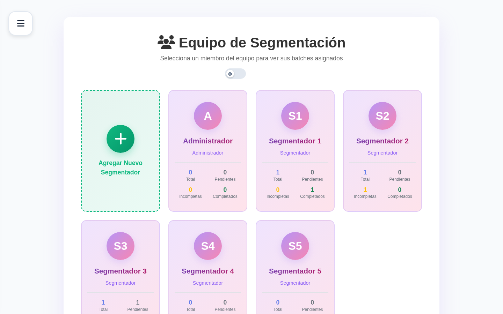
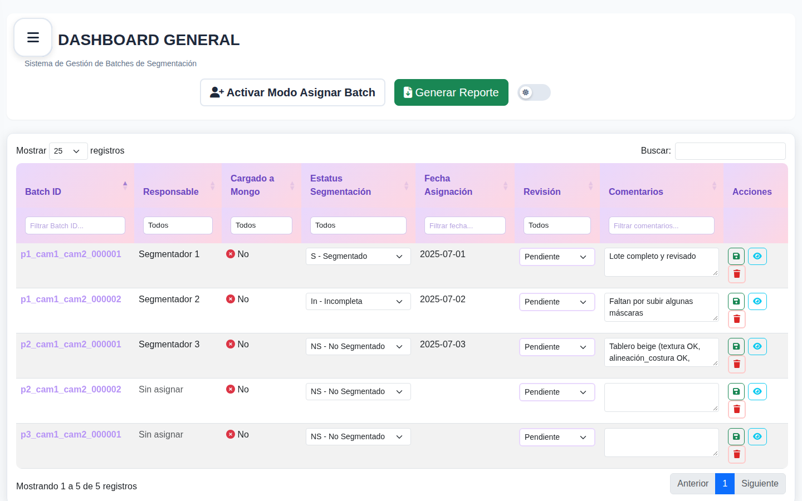

# Gestor de Lotes de Anotación

Aplicación web para asignar, dar seguimiento y medir el avance de lotes (*batches*) de segmentación de imágenes, usados para entrenar modelos de visión por computadora en **inspección industrial del sector automotriz**.

Desarrollada en Enerv DeepEye, una startup de visión por computadora. Esta es una **versión de portafolio con datos ficticios**.

<!-- TODO: agregar las capturas en docs/img/ (equipo.png y dashboard.png) -->



## El problema

El equipo de segmentación trabajaba con cientos de lotes de imágenes en varias plantas, cada una con su propia base de datos. Faltaba una forma centralizada de saber quién tenía asignado cada lote, en qué estado estaba y cuánto avance llevaba cada persona.

## ¿Cómo se maneja un lote?

El sistema **no almacena las imágenes**. Cada lote se registra como un documento JSON que hace referencia a la carpeta donde están las imágenes e incluye la **especificación del lote**, para que quien segmenta tenga todo el contexto a la mano. Así la aplicación se mantiene ligera y rápida, y las imágenes se quedan en su almacenamiento original.

Ejemplo de un lote (datos ficticios, tomado de [`data/batches_ejemplo.json`](data/batches_ejemplo.json)):

```json
{
  "id": "p1_cam1_cam2_000002",
  "assignee": "Segmentador 2",
  "folder": "./data/imagenes/p1_cam1_cam2_000002",
  "tasks": ["segmentar", "subir_mascaras", "revisar"],
  "specification": "Panel de puerta negro (costura NOK, arruga OK, rayón OK, mancha OK)",
  "metadata": {
    "assigned_at": "2025-07-02",
    "due_date": "2025-07-10",
    "priority": "alta",
    "reviewed_at": null
  },
  "status": "FS",
  "mongo_uploaded": true,
  "comments": "Faltan por subir algunas máscaras"
}
```

| Campo | Tipo | Descripción |
|---|---|---|
| `id` | texto | Identificador único del lote. El formato `pN_cam1_cam2_NNNNNN` indica la pieza (`pN`), las cámaras de captura y el consecutivo; también se aceptan IDs `batch_XXX`. |
| `assignee` | texto o `null` | Segmentador responsable. Vacío o `null` = sin asignar. |
| `folder` | texto | Ruta de la carpeta con las imágenes del lote (las imágenes no se guardan en la BD). Por defecto `DATA_DIRECTORY/<id>`. |
| `tasks` | lista | Pasos del flujo de trabajo: `segmentar`, `subir_mascaras`, `revisar`. |
| `specification` | texto | **Especificación del lote:** pieza, color y la lista de criterios de inspección con su resultado esperado (`OK` = sin defecto, `NOK` = con defecto a segmentar). |
| `metadata.assigned_at` | fecha (`AAAA-MM-DD`) o `null` | Fecha en que se asignó el lote. |
| `metadata.due_date` | fecha o `""` | Fecha límite de entrega. |
| `metadata.priority` | texto | Prioridad: `baja`, `media` o `alta`. |
| `metadata.reviewed_at` | fecha o `null` | Fecha en que se revisó el lote terminado. |
| `status` | texto | Estado de segmentación: `NS`, `FS` o `S` (ver [Estados de un lote](#estados-de-un-lote)). |
| `mongo_uploaded` | booleano | Si las máscaras del lote ya están en MongoDB. Se actualiza con la sincronización de máscaras. |
| `comments` | texto | Observaciones libres. |

## La solución

- **Vista de equipo:** tarjetas por cada integrante con estadísticas en tiempo real de sus lotes asignados.
- **Dashboard de gestión:** tabla con filtros por responsable y estado, y edición directa (inline) de estados y fechas límite.
- **Asignación y reasignación de lotes** entre integrantes del equipo, incluida la carga rápida de lotes pegando una lista de IDs.
- **Gestión del equipo con roles** (`admin` / `segmentador`): el equipo siempre tiene al menos un administrador (se crea uno al arrancar si no existe y no se puede eliminar ni degradar al último), y dar de alta a un administrador o convertir a alguien en administrador requiere la contraseña de administrador.
- **Configuración por planta:** cada instancia apunta a la base de datos de su planta mediante variables de entorno.
- **Sincronización de máscaras:** relaciona las máscaras de segmentación guardadas en MongoDB (en la base principal y en la base externa del segmentador) con su lote correspondiente.
- **Métricas optimizadas** con pipelines de agregación de MongoDB.
- **Exportación y respaldo:** reportes en Excel y CSV, y respaldo completo de la base en JSON.

## Tecnologías

| Capa | Tecnología |
|---|---|
| Backend | Python, Flask, Gunicorn |
| Base de datos | MongoDB (PyMongo) |
| Frontend | Bootstrap 5, jQuery, DataTables, Font Awesome |
| Reportes | openpyxl, CSV |

## Estructura del proyecto

```
gestor-lotes-anotacion/
├── app.py                    # Aplicación Flask y rutas
├── db.py                     # Conexión a MongoDB (lee .env) e índices
├── templates/                # Vistas HTML (equipo, dashboard, métricas, máscaras)
├── static/                   # CSS y JavaScript
├── scripts/                  # Utilidades de mantenimiento
│   ├── init_db.py            #   Crea colecciones, índices y un equipo de ejemplo
│   ├── load_batches.py       #   Carga un JSON de lotes a MongoDB
│   ├── reassign_batch.py     #   Reasigna un lote
│   ├── mass_reassign.py      #   Reasignación masiva
│   ├── analyze_assignees.py  #   Detecta lotes asignados a personas fuera del equipo
│   ├── check_batch.py        #   Muestra el estado de un lote
│   ├── sync_masks_with_batches.py  # Sincroniza máscaras con lotes
│   ├── health_check.sh       #   Verifica MongoDB y la aplicación
│   └── start_gunicorn.sh     #   Arranque en producción
├── data/
│   └── batches_ejemplo.json  # 5 lotes ficticios
├── docs/
│   └── ARQUITECTURA.md       # Arquitectura, modelo de datos y flujos
├── tests/
│   ├── conftest.py           # Fixtures (BD de prueba aislada)
│   ├── test_api.py           # Pruebas de la API
│   └── fixtures/             # JSON de prueba
├── gunicorn_config.py        # Configuración para producción
├── .env.example              # Plantilla de variables de entorno
└── requirements.txt
```

## Instalación

**Requisitos:** Python 3.10+ y MongoDB en ejecución.

```bash
git clone https://github.com/EstefaniaServinP/gestor-lotes-anotacion.git
cd gestor-lotes-anotacion

python3 -m venv .venv
source .venv/bin/activate
pip install -r requirements.txt

cp .env.example .env      # Ajusta la conexión a tu MongoDB y ADMIN_PASSWORD

python3 scripts/init_db.py        # Crea índices y un equipo de ejemplo (1 admin + 5 segmentadores)
python3 scripts/load_batches.py   # Carga data/batches_ejemplo.json
python3 app.py
```

La aplicación queda disponible en `http://localhost:5000` (configurable con `PORT` en `.env`).

Para producción:

```bash
gunicorn -c gunicorn_config.py app:app
```

## API

Principales rutas de [`app.py`](app.py):

| Método | Ruta | Descripción |
|---|---|---|
| `GET` | `/api/batches` | Lista los lotes (paginado: `page`, `per_page`) |
| `POST` | `/api/batches` | Crea un lote |
| `PUT` | `/api/batches/<id>` | Actualiza un lote (responsable, estado, especificación, metadatos…) |
| `PUT` | `/api/batches/<id>/change-id` | Cambia el ID de un lote |
| `DELETE` | `/api/batches/<id>` | Elimina un lote |
| `POST` | `/api/batches/quick-create` | Crea varios lotes a partir de una lista de IDs pegada como texto |
| `POST` | `/api/init-batches` | Carga los datos de ejemplo si la colección está vacía (`force: true` para recargar) |
| `POST` | `/api/reset-batches` | Borra los lotes y recarga los datos de ejemplo |
| `GET` | `/api/missing-batches` | Lotes del catálogo de ejemplo que aún no están en la BD |
| `POST` | `/api/data/batches/upload` | Carga lotes desde un JSON (`mode`: `add` o `replace`) |
| `POST` | `/api/data/batches/delete-by-filter` | Elimina lotes por filtros |
| `GET` | `/api/data/batches/export` | Exporta todos los lotes en JSON |
| `GET` | `/api/data/batches/stats` | Estadísticas de la colección de lotes |
| `GET` | `/api/segmentadores` | Lista el equipo |
| `POST` | `/api/add-segmentador` | Agrega un integrante |
| `PUT` | `/api/update-segmentador` | Edita un integrante |
| `DELETE` | `/api/remove-segmentador` | Elimina un integrante |
| `POST` | `/api/validate-admin-password` | Valida la contraseña de administrador |
| `GET` | `/api/check-mongo-files` | Lista las máscaras encontradas en MongoDB |
| `GET` | `/api/batch-files/<id>` | Máscaras asociadas a un lote |
| `POST` | `/api/sync-batch-files` | Sincroniza `mongo_uploaded` con las máscaras existentes |
| `POST` | `/api/auto-create-batches` | Crea lotes a partir de las máscaras encontradas |
| `GET` | `/api/metrics/overview` | Métricas generales |
| `GET` | `/api/metrics/team` | Métricas por integrante |
| `GET` | `/api/metrics/progress` | Avance en el tiempo |
| `GET` | `/api/metrics/export` | Exporta métricas en CSV |
| `GET` | `/api/batch-assignment/metrics` | Métricas de asignación |
| `POST` | `/api/export/batches` | Reporte de lotes en Excel o CSV |
| `GET` | `/api/export/segmentador/<nombre>` | CSV con los lotes de un integrante |
| `GET` | `/api/export/all-assignments` | CSV con el resumen de asignaciones |
| `GET` | `/api/backup/database` | Respaldo completo (lotes y equipo) en JSON |

## Estados de un lote

| Código | Estado | Significado |
|---|---|---|
| `NS` | 🟡 Pendiente | No segmentado; sin comenzar |
| `FS` | 🔵 Parcial | Segmentación en progreso o incompleta |
| `S` | 🟢 Segmentado | Listo para revisión y entrenamiento |

## Pruebas

```bash
python3 -m pytest tests/
```

Las pruebas usan una base de datos aislada (`gestor_lotes_test`) en el MongoDB local, que se borra al terminar. Si MongoDB no está disponible, se omiten. Para usar otro servidor: `TEST_MONGO_URI=mongodb://... pytest tests/`.

## Autora

**Estefanía Portillo Balderas**, desarrolladora de software e inteligencia artificial.
[LinkedIn](https://www.linkedin.com/in/estefania-portillo-318b70365)