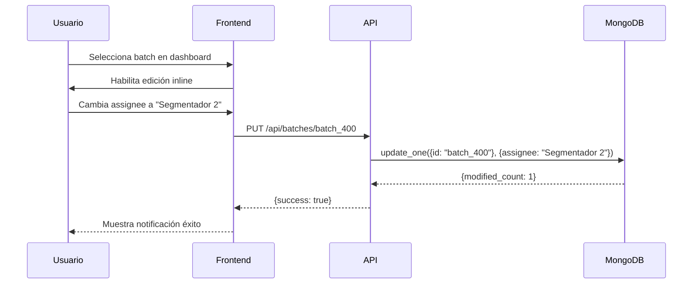
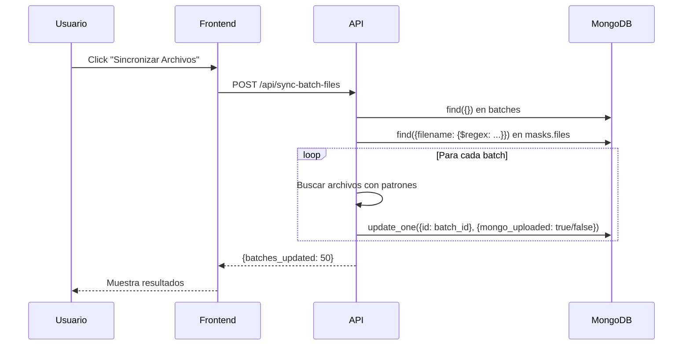
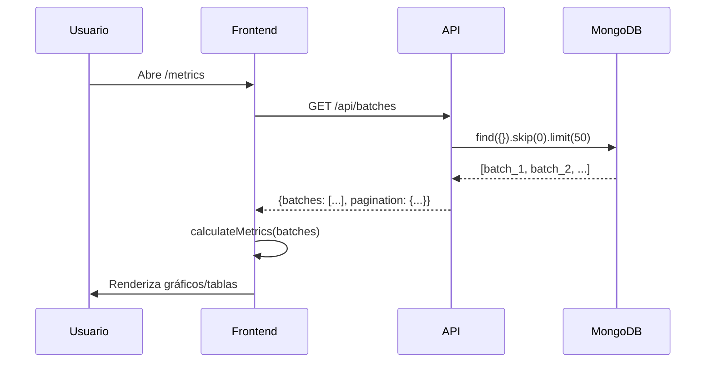

# 📊 Arquitectura del Sistema - Gestor de Lotes de Anotación

> **Proyecto:** Gestor de lotes de segmentación de imágenes para inspección industrial automotriz
> **Versión:** 1.0.0
> **Nota:** versión de portafolio; los nombres y datos son ficticios.

---

## 🏗️ Arquitectura General

```
┌─────────────────────────────────────────────────────────────┐
│                      FRONTEND (Cliente)                      │
├─────────────────────────────────────────────────────────────┤
│  Templates (Jinja2)       │ JavaScript         │ CSS          │
│  ──────────────────────── │ ────────────────── │ ──────────── │
│  • base.html + _sidebar   │ • sidebar.js       │ • Bootstrap 5│
│  • team.html              │ • data_management  │ • sidebar.css│
│  • dashboard.html         │   .js              │ • estilos    │
│  • batch_management.html  │ • JS inline en     │   inline por │
│  • batch_assignment_v2    │   cada plantilla   │   plantilla  │
│  • data_management.html   │ • jQuery,          │              │
│  • metrics_overview.html  │   DataTables       │              │
│  • masks.html, error.html │                    │              │
└─────────────────────────────────────────────────────────────┘
                            ↓ HTTP/JSON
┌─────────────────────────────────────────────────────────────┐
│                    BACKEND (Flask Server)                    │
├─────────────────────────────────────────────────────────────┤
│  app.py (Rutas y API REST)                                  │
│  ─────────────────────────────────────────────────────────  │
│  • Rutas de vistas (render_template)                        │
│  • Endpoints API (/api/*)                                   │
│  • Lógica de negocio                                        │
└─────────────────────────────────────────────────────────────┘
                            ↓ PyMongo
┌─────────────────────────────────────────────────────────────┐
│                   CAPA DE DATOS (db.py)                      │
├─────────────────────────────────────────────────────────────┤
│  • Conexión MongoDB                                         │
│  • Gestión de cliente                                       │
│  • Creación de índices                                      │
└─────────────────────────────────────────────────────────────┘
                            ↓ MongoDB Protocol
┌─────────────────────────────────────────────────────────────┐
│                   BASE DE DATOS (MongoDB)                    │
├─────────────────────────────────────────────────────────────┤
│  Database: planta_a (MONGO_DB)                              │
│  ─────────────────────────                                  │
│  • Colección: batches (documentos de batches)               │
│  • Colección: segmentadores (equipo y roles)                │
│  • Colección: masks.files (GridFS para máscaras)            │
└─────────────────────────────────────────────────────────────┘
```

---

## 🔧 BACKEND - Componentes Principales

### 1. **db.py** - Capa de Acceso a Datos

#### Funciones:
- **`get_client()`**: Singleton de conexión MongoDB
- **`ping_client(timeout_ms=2000)`**: Verificar conectividad
- **`get_db(raise_on_fail=True)`**: Obtener instancia de BD
- **`create_indexes()`**: Crear índices optimizados
- **`close_client()`**: Cerrar conexión

#### Configuración:
```python
load_dotenv()  # lee .env si existe
MONGO_URI = os.environ.get("MONGO_URI", "mongodb://localhost:27017")
DB_NAME = os.environ.get("MONGO_DB", "planta_a")
```

#### Índices Creados:
- `batches`: `id` (único), `assignee`, `status`, `metadata.assigned_at` y compuestos `assignee+status`, `status+metadata.assigned_at`
- `masks.files`: `filename`, `uploadDate`
- `Reporte_avances_masks`: `batch_id`, `fecha`, `segmentador`

---

### 2. **app.py** - Servidor Flask & API REST

#### Variables Globales:
```python
CREW_MEMBERS = []  # se carga desde la colección segmentadores
db = None
batches_col = None
masks_col = None
```

#### Inicialización:
```python
def init_db():
    # Conexión diferida a MongoDB
    # Creación de índices en background
```

---

## 🌐 RUTAS DEL SISTEMA

### **Rutas de Vistas** (Templates HTML)

| Ruta | Template | Descripción |
|------|----------|-------------|
| `/` | `team.html` | Página principal - Vista de equipo |
| `/team` | `team.html` | Vista de tarjetas de equipo |
| `/dashboard` | `dashboard.html` | Dashboard con tabla editable |
| `/dashboard/<assignee>` | `dashboard.html` | Dashboard filtrado por responsable |
| `/assign` | `batch_management.html` | Asignación de batches |
| `/batch-management` | → Redirect a `/assign` | Compatibilidad |
| `/batch-assignment-v2` | `batch_assignment_v2.html` | Interfaz alternativa de asignación |
| `/masks` | `masks.html` | Visualización de máscaras MongoDB |
| `/metrics` | `metrics_overview.html` | Métricas generales |
| `/data-management` | `data_management.html` | Carga desde JSON, exportación y borrado por filtros |

---

### **API REST Endpoints**

#### **CRUD de Batches**

##### `GET /api/batches`
**Descripción:** Obtener batches paginados
**Parámetros:**
- `page` (int, default=1): Número de página
- `per_page` (int, default=50, min=5, max=1000): Batches por página

**Respuesta:**
```json
{
  "batches": [...],
  "pagination": {
    "page": 1,
    "per_page": 50,
    "total": 500,
    "total_pages": 10
  }
}
```

##### `POST /api/batches`
**Descripción:** Crear nuevo batch
**Body:**
```json
{
  "id": "batch_123",
  "assignee": "Segmentador 1",
  "folder": "./data/imagenes/batch_123",
  "specification": "Panel de puerta gris (costura OK, arruga NOK)",
  "status": "NS",
  "metadata": {
    "assigned_at": "2025-07-23",
    "due_date": "2025-07-30",
    "priority": "media"
  },
  "comments": "Batch inicial"
}
```

##### `PUT /api/batches/<batch_id>`
**Descripción:** Actualizar batch existente
**Body:** (campos opcionales)
```json
{
  "assignee": "Segmentador 2",
  "status": "S",
  "metadata": {
    "due_date": "2025-08-01"
  }
}
```

##### `DELETE /api/batches/<batch_id>`
**Descripción:** Eliminar batch
**Respuesta:**
```json
{
  "success": true,
  "message": "Batch batch_123 eliminado",
  "deleted_batch": {...}
}
```

##### `PUT /api/batches/<batch_id>/change-id`
**Descripción:** Cambiar ID de un batch
**Body:**
```json
{
  "new_id": "batch_456"
}
```

---

#### **Gestión de Segmentadores**

##### `POST /api/add-segmentador`
**Descripción:** Agregar nuevo segmentador
**Body:**
```json
{
  "name": "Nuevo Segmentador",
  "role": "segmentador",          // o "admin" (requiere admin_password)
  "email": "email@ejemplo.com"
}
```

##### `GET /api/segmentadores`
**Descripción:** Obtener lista de segmentadores
**Respuesta:**
```json
{
  "success": true,
  "segmentadores": [{"name": "Segmentador 1", "role": "admin", "email": ""}, ...],
  "total": 5
}
```

---

#### **Operaciones MongoDB**

##### `GET /api/check-mongo-files`
**Descripción:** Verificar archivos en GridFS
**Respuesta:**
```json
{
  "success": true,
  "total_files": 150,
  "recent_files": [...],
  "batch_patterns": {
    "batch_400": ["masks_batch_400.tar.xz", ...]
  }
}
```

##### `GET /api/batch-files/<batch_id>`
**Descripción:** Obtener archivos de un batch
**Respuesta:**
```json
{
  "batch_id": "batch_400",
  "total_files": 3,
  "latest_upload": "2025-07-23T10:30:00",
  "uploaded_by": "Segmentador 1",
  "file_size": 1048576,
  "all_uploads": [...]
}
```

##### `POST /api/sync-batch-files`
**Descripción:** Sincronizar estado `mongo_uploaded` con archivos reales
**Lógica:**
```python
# Busca archivos con patrones:
patterns = [
    f"masks_batch_{batch_number}",
    f"batch_{batch_number}",
    f"Batch_{batch_number}",
    ...
]
# Actualiza mongo_uploaded: true/false
```

##### `POST /api/auto-create-batches`
**Descripción:** Crear batches automáticamente desde archivos en MongoDB
**Lógica:**
```python
# 1. Extrae números de batch de nombres de archivo
# 2. Crea batches faltantes
# 3. Los crea sin asignar
```

##### `POST /api/init-batches`
**Descripción:** Inicializar batches desde `data/batches_ejemplo.json` (configurable con `BATCHES_FILE`)
**Body:**
```json
{
  "force": false  // true = limpiar y recargar
}
```

##### `POST /api/reset-batches`
**Descripción:** Limpiar y recargar todos los batches desde JSON

##### `GET /api/missing-batches`
**Descripción:** Obtener lista de batches pendientes (no en DB)
**Respuesta:**
```json
{
  "success": true,
  "missing_batches": ["batch_9", "batch_10", ...],
  "total_missing": 50,
  "total_existing": 450
}
```

---

## 🎨 FRONTEND - Estructura

### **1. Templates HTML (Jinja2)**

Todas las vistas extienden `base.html`, que carga las librerías comunes, el sidebar y define bloques para el CSS y el JavaScript de cada página:

```html
<head>
  <!-- Bootstrap 5.3 y Font Awesome 6.4 (CDN) -->
     <!-- p. ej. DataTables -->
  <link href="static/css/sidebar.css">
  
</head>
<body>
               <!-- menú lateral unificado -->
  <div class="main-content"></div>

  <!-- jQuery 3.7 y Bootstrap JS (CDN) -->
  
  <script src="static/js/sidebar.js"></script>
           <!-- JS propio de la vista -->
</body>
```

| Plantilla | Ruta | Contenido |
|-----------|------|-----------|
| `team.html` | `/`, `/team` | Tarjetas del equipo, alta/edición/baja de segmentadores |
| `dashboard.html` | `/dashboard`, `/dashboard/<assignee>` | Tabla de lotes con edición inline, filtros y reportes |
| `batch_management.html` | `/assign` | Asignación de lotes y sincronización con MongoDB |
| `batch_assignment_v2.html` | `/batch-assignment-v2` | Interfaz alternativa de asignación |
| `data_management.html` | `/data-management` | Carga desde JSON, exportación, borrado por filtros y estadísticas |
| `metrics_overview.html` | `/metrics` | Métricas generales y por integrante |
| `masks.html` | `/masks` | Máscaras encontradas en MongoDB |
| `error.html` | — | Página de error (acceso denegado) |
| `_sidebar.html`, `theme_system.html` | — | Parciales: menú lateral y modo claro/oscuro |

---

### **2. JavaScript**

La lógica de cada vista vive en el bloque `page_js` de su plantilla. Los archivos estáticos son solo dos:

#### **sidebar.js** - Menú lateral unificado
- Abrir/cerrar el sidebar (botón hamburguesa, overlay y tecla Escape)
- Submenú colapsable de Métricas
- Accesibilidad (ARIA, teclado)

**Funciones principales:**
```javascript
function toggleSidebar() / openSidebar() / closeSidebar()
function toggleMetricsSubmenu(event)
function handleMetricsTriggerKeydown(event)
```

#### **data_management.js** - Gestión de datos
- Carga de lotes desde JSON (`add` / `replace`)
- Exportación a JSON y borrado por filtros
- Estadísticas de la colección

---

### **3. CSS**

- **Bootstrap 5.3** como base de estilos y componentes.
- **`sidebar.css`**: estilos del menú lateral unificado (glassmorphism, transiciones, responsive).
- Estilos propios de cada vista en su bloque `page_css`, y el modo claro/oscuro en `theme_system.html`.

---

## 📊 MODELO DE DATOS (MongoDB)

### **Colección: batches**

```javascript
{
  "_id": ObjectId("..."),
  "id": "batch_400",              // ID único del batch
  "assignee": "Segmentador 1",     // Responsable
  "folder": "./data/imagenes/batch_400", // Ruta de las imágenes del batch
  "tasks": [                       // Tareas pendientes
    "segmentar",
    "subir_mascaras",
    "revisar"
  ],
  "specification": "Panel de puerta gris (costura OK, arruga NOK)", // Especificación del lote
  "metadata": {
    "assigned_at": "2025-07-23",   // Fecha de asignación
    "due_date": "2025-07-30",      // Fecha límite
    "priority": "media",           // Prioridad: baja/media/alta
    "reviewed_at": null            // Fecha de revisión
  },
  "status": "NS",                  // NS/In/S (No segmentado/Incompleta/Segmentado)
  "mongo_uploaded": true,          // Si tiene archivos en MongoDB
  "comments": "Comentarios...",    // Observaciones
  "file_info": {                   // Metadatos de archivos (opcional)
    "file_count": 3,
    "last_file_upload": "2025-07-23T10:30:00Z",
    "has_files": true,
    "files": ["masks_batch_400.tar.xz"]
  }
}
```

#### **Estados Posibles:**
- `NS` (No Segmentado): Pendiente
- `In` (Incompleta): segmentación en progreso
- `S` (Segmentado): Completado

---

### **Colección: masks.files** (GridFS)

```javascript
{
  "_id": ObjectId("..."),
  "filename": "masks_batch_400.tar.xz",
  "uploadDate": ISODate("2025-07-23T10:30:00Z"),
  "length": 1048576,               // Tamaño en bytes
  "chunkSize": 261120,
  "metadata": {
    "uploaded_by": "Segmentador 1",
    "content_type": "application/x-xz"
  }
}
```

---

## 🔄 FLUJO DE TRABAJO TÍPICO

### **Caso 1: Asignar Batch a Segmentador**



---

### **Caso 2: Sincronizar Archivos MongoDB**



---

### **Caso 3: Visualizar Métricas**



---

## 🎯 CARACTERÍSTICAS PRINCIPALES

### **1. Paginación**
- Implementada en `/api/batches`
- Límite: 5-1000 batches/página
- Optimiza rendimiento con grandes datasets

### **2. Edición Inline**
- Click en campo → input editable
- Save: blur o Enter
- Cancel: Escape
- Actualización inmediata en DB

### **3. Filtrado Dinámico**
- Por responsable (dropdown)
- DataTable search global
- Métricas se actualizan en tiempo real

### **4. Sincronización MongoDB**
- Detecta archivos por patrones regex
- Actualiza campo `mongo_uploaded`
- Soporta múltiples formatos (.tar.xz, .tar.gz, .zip)

### **5. Gestión de Equipo**
- Agregar, editar y eliminar segmentadores (colección `segmentadores`)
- Roles `admin` / `segmentador`; crear un admin o promover a alguien a admin requiere `ADMIN_PASSWORD`
- Siempre hay al menos un admin: al arrancar se crea `ADMIN_NAME` (por defecto "Administrador") si no existe ninguno, y la API rechaza (409) eliminar o degradar al último
- Lista cacheada en memoria (CREW_MEMBERS)
- Disponible en todos los selectores

### **6. Accesibilidad**
- ARIA labels en menú
- Soporte teclado (Tab, Enter, Escape)
- Focus visible
- Semantic HTML

---

## 🔐 SEGURIDAD Y BUENAS PRÁCTICAS

### **Implementadas:**
✅ Validación de entrada en endpoints
✅ Manejo de errores con try/except
✅ Logging de operaciones críticas
✅ Índices únicos en MongoDB
✅ Conexión MongoDB con timeout
✅ Variables de entorno para secretos (python-dotenv)
✅ CORS implícito (mismo origen)

### **Pendientes (Recomendadas):**
⚠️ Autenticación de sesión y protección de rutas por rol
⚠️ Rate limiting en API
⚠️ Sanitización de inputs HTML
⚠️ HTTPS en producción
⚠️ Backup automático MongoDB (hoy es manual: `GET /api/backup/database`)

---

## 🚀 DESPLIEGUE

### **Desarrollo:**
```bash
python app.py
# Servidor en http://localhost:5000
```

### **Producción (Recomendado):**
```bash
gunicorn -c gunicorn_config.py app:app
```

### **Variables de Entorno:**
Se definen en `.env` (ver `.env.example`):
```bash
MONGO_URI=mongodb://localhost:27017
MONGO_DB=planta_a
ADMIN_PASSWORD=cambia-esta-contraseña
```

---

## 📈 MÉTRICAS Y MONITOREO

### **Endpoints de Monitoreo:**
- `/api/batches` → Total de batches
- `/api/check-mongo-files` → Archivos en GridFS
- `/api/segmentadores` → Tamaño del equipo

### **Logs:**
```python
print("✅ Batch batch_400 actualizado")
print("❌ Error en get_batches:", e)
print("🔄 Sincronización completa: 50 batches actualizados")
```

---

## 🎓 TECNOLOGÍAS UTILIZADAS

### **Backend:**
- **Flask** 2.x - Framework web
- **PyMongo** 4.x - Driver MongoDB
- **Python** 3.10+

### **Frontend:**
- **Bootstrap** 5.3 - UI framework
- **jQuery** 3.7 - Manipulación DOM
- **DataTables** 1.13 - Tablas interactivas
- **Font Awesome** 6.4 - Iconografía

### **Base de Datos:**
- **MongoDB** 6.x+ - NoSQL database
- **GridFS** - Almacenamiento de archivos

---

## 📝 CONVENCIONES DE CÓDIGO

### **Python:**
- **PEP 8** - Estilo de código
- **snake_case** para funciones/variables
- **UPPER_CASE** para constantes
- Docstrings en endpoints

### **JavaScript:**
- **camelCase** para funciones/variables
- **async/await** para operaciones asíncronas
- **const/let** (no var)
- Comentarios descriptivos

### **MongoDB:**
- **snake_case** para campos
- **id** sin guion bajo (no _id para documentos propios)
- Metadatos en objetos anidados

---

## 🔄 VERSIONAMIENTO

**Sistema:** Git
**Branches:**
- `main` - Producción
- `develop` - Desarrollo
- `feature/*` - Features

**Commits:**
- ✨ Feature nueva
- 🐛 Bug fix
- 📝 Documentación
- ♻️ Refactoring
- 🎨 Estilos/UI

---

## 📚 RECURSOS ADICIONALES

- **Flask Docs:** https://flask.palletsprojects.com/
- **PyMongo Docs:** https://pymongo.readthedocs.io/
- **Bootstrap 5:** https://getbootstrap.com/docs/5.3/
- **DataTables:** https://datatables.net/
- **MongoDB Docs:** https://www.mongodb.com/docs/

---
